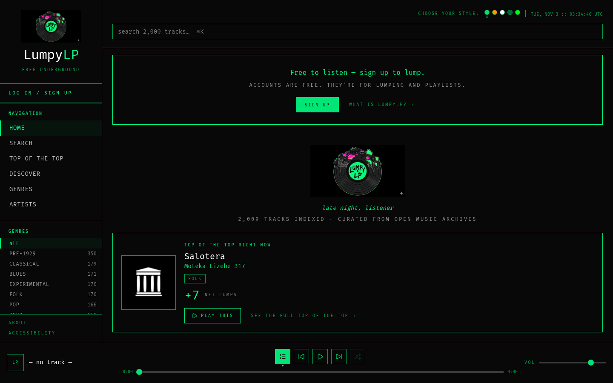
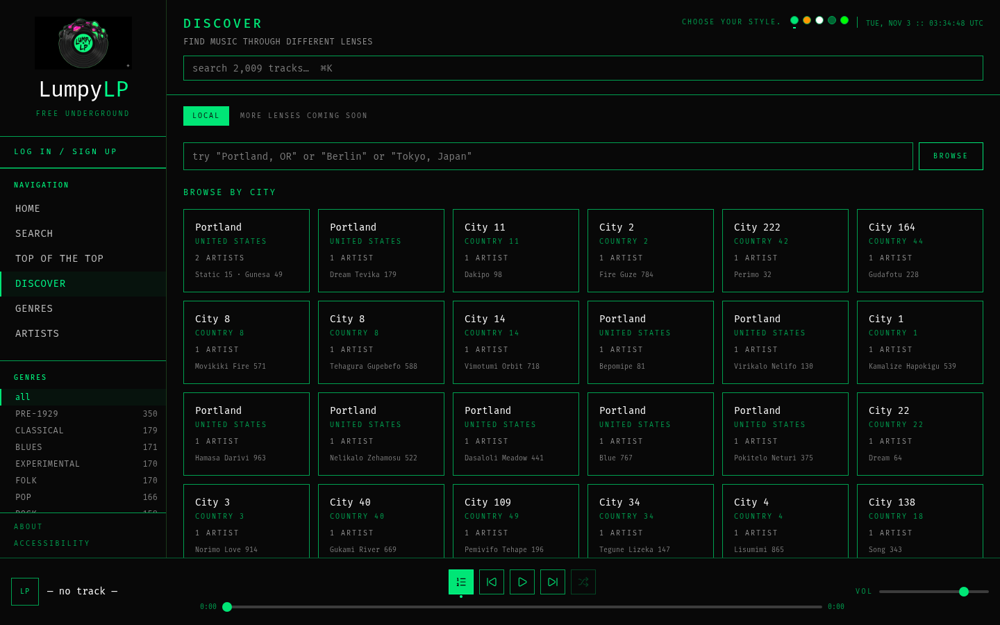
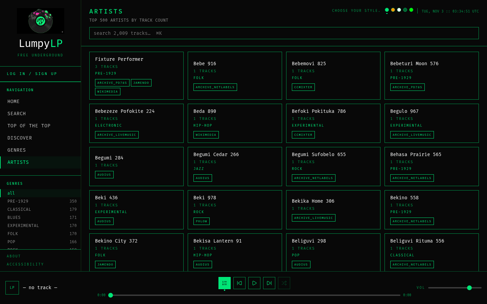
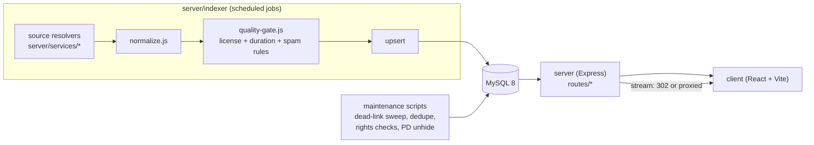

# LumpyLP

A streaming library of legally free music: Creative Commons and public-domain recordings gathered from open archives, with curation left entirely to listeners. Nothing in the product ranks or recommends tracks; what rises is what people vote up ("lump"). The hard part is not the player, it is the catalog: eighteen sources describe licenses, rights, artists and locations in eighteen different ways, and a track should only be playable when its rights are actually clear.



| Discover by location | Artists |
|---|---|
|  |  |

Screenshots show the synthetic test catalog, not real data.

## Architecture



- **Indexer** (`server/indexer/`): one resolver per source in `server/services/`. Each resolver fetches and maps a source's records to one track shape; `normalize.js` cleans fields and `quality-gate.js` decides what is admitted. Rejections go to a log, not silently away.
- **API** (`server/routes/`): tracks, search, genres, artists, location discovery, lumps (playlists), votes, accounts and admin moderation. It connects as a least-privilege database user; the indexer and maintenance scripts use a separate user (`server/db/grants.sql`).
- **Client** (`client/`): React, TypeScript, Vite and Tailwind. The API is same-origin; in development Vite proxies `/api` to the server.
- **Offline curation tooling** (`tools/scout/`): a research agent used by the maintainer to find new candidate sources. It is not part of the user-facing product (see below).

## Stack

- Node.js 24, Express 4, mysql2, Zod, bcrypt, jsonwebtoken, express-rate-limit
- MySQL 8
- React 18, TypeScript, Vite, Tailwind
- Python 3 and a local Ollama model for the offline scout tooling
- Tests: `node:test` against a real, throwaway MySQL instance

## Technically notable parts

**Source resolvers.** Eighteen catalog sources (`server/lib/sources.js`), including five Internet Archive collection resolvers, Audius, Jamendo, ccMixter, Wikimedia Commons, the Library of Congress National Jukebox, UCSB cylinder recordings, Musopen, Free Music Archive, Europeana and Smithsonian. Each one handles its own paging, politeness delays and User-Agent rules. Streams are resolved per source at play time: most redirect to the origin, Audius resolves a healthy CDN node with failover, and ccMixter is proxied server-side because it checks the Referer. The proxy only ever fetches `https://ccmixter.org`, with TLS verification on and timeouts set.

**License gate.** `quality-gate.js` admits only an explicit set of licenses (the CC families, CC0, public domain, Free Art, Sampling Plus, and platform terms that grant streaming). Raw license strings from every source are mapped onto canonical slugs (`server/lib/licenses.js`), and a test checks that every raw value observed in production has a mapping, so a new spelling cannot slip through as "unknown". Each track carries attribution and a link to the item's own page, which holds the exact license.

**Public-domain dates.** US sound recordings enter the public domain on fixed dates under 17 USC 1401. Recordings that are not yet public domain are hidden with a dated reason, and `server/scripts/unhide-pd-effective.js` (meant for a yearly timer) unhides exactly the rows whose date has arrived, leaving every other hide alone. A separate migration hides items whose uploaders labelled them public domain but whose dates say otherwise.

**Catalog hygiene.** A dead-link sweep with fresh, rescue and revive modes; within-source dedupe that moves lump entries and votes to the kept row and can be undone by run id; rights checks for Library of Congress and Wikimedia items; and per-track hide/unhide for takedowns (`docs/TAKEDOWNS.md`).

**Location discovery.** Artist locations come from source metadata and geocoding (Nominatim, globally paced to one request per second, with a test that fires parallel lookups and checks the spacing). `/api/discover` does radius search with a Haversine expression in SQL so results can be ordered by distance.

**Accounts and abuse controls.** Passwords are bcrypt-hashed. JWTs carry a `token_version`; bumping it on a password change or admin reset revokes every outstanding token at once. Signup is behind Cloudflare Turnstile. Rate limits are per IP or per user depending on the route (login, failed logins per IP and username, signup, password changes, lump writes, votes, search), and in production the server logs a warning if its first 50 API requests arrive without a forwarded client IP, since the IP-keyed limits would otherwise collapse into one global bucket.

**Tests that cannot touch the wrong database.** The suite starts its own user-level MySQL on `127.0.0.1:33306` with data in `/tmp`, builds the schema, seeds a deterministic synthetic catalog, and connects as the same least-privilege user production uses. A guard refuses to run against anything other than that local `*_test` database. 108 tests across 23 files cover auth, rate limits, grants, migrations (including a dump-before-drop migration runner), the stream proxy, dedupe, link checks, public-domain rules, query shapes and repository hygiene (no secrets or non-placeholder values in tracked files). A separate harness (`npm run perf`) builds a 650,000-track synthetic database and times every endpoint end to end while running `EXPLAIN` on each SQL statement to flag full scans and filesorts.

**Offline curation tooling.** `tools/scout/` is a ReAct-style agent loop over a local Ollama model (default `llama3.1:8b-instruct`) with web search, fetch and API-verification actions. It looks for new archives of openly licensed music and logs candidates to SQLite for the maintainer to review by hand, with a blocklist of sources already integrated or rejected. It is not part of the product: it never runs on the server, never touches the catalog, and nothing a listener hears is chosen by a model.

## Running locally

Requirements: Node.js 24 and a MySQL 8 server binary (`mysqld`, for example from the `mysql-server` package; it does not need to be running as a service). The steps below run the app against the synthetic test catalog, so no external API keys are needed.

```bash
git clone https://github.com/elijahsylar/lumpylp.git
cd lumpylp
cd server && npm install && cd ../client && npm install && cd ..

# 1. Start a throwaway MySQL (127.0.0.1:33306, data in /tmp) and seed it.
cd server
npm run testdb:start
npm run test:setup
cd ..

# 2. Point the app at it.
cp .env.example .env
#   then set, in .env:
#   DB_HOST=127.0.0.1
#   DB_PORT=33306
#   DB_NAME=lumpylp_test
#   DB_USER=lumpylp_app
#   DB_PASS=app-test-only
#   DB_SSL_CA=
#   JWT_SECRET=<any long random string>

# 3. Run the API and the client (two terminals).
cd server && npm run dev          # http://127.0.0.1:3001
cd client && npm run dev          # http://localhost:5173

# 4. When done.
cd server && npm run testdb:stop
```

To index real sources instead, create a MySQL database, apply `server/db/schema.sql` and the files in `server/migrations/`, fill in the source credentials in `.env`, and run `npm run index` in `server/`.

### Tests

```bash
cd server
npm run testdb:start
npm test                          # 108 tests
npm run lint
cd ../client && npx tsc -b && npx eslint .
```

`scripts/check.sh` runs all of the above plus a production build of the client.

## Project status

The public site is paused. The code here is the relaunch branch: Stripe and paid uploads removed, free accounts behind Turnstile, admin moderation, least-privilege database users and the test suite above. The client has no automated tests yet.

## License

MIT. See [LICENSE](LICENSE). Audio is not included; every track is streamed from its original archive under that archive's license.
